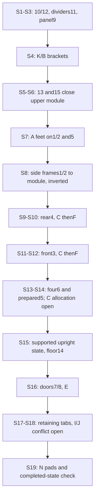

# Product #03 - documentary assembly dependencies

**19/19 OEM steps covered.** The conservative dependency chain retains the manual order; this is a source ledger, not implemented animation. Unobserved support/tool access is not validated by a diagram.

| Step | PDF / printed page | New part IDs | Hardware | Operation | Receiving/access notes |
|---|---|---|---|---|---|
| S01 | 4 / 3 | 10, 12 | Dx4 | Connect the two 10 panels to the ends of 12; align the indicated hole faces before seating D. | Across outer 10 faces toward 12 ends. Receiving geometry beyond depicted holes UNKNOWN. |
| S02 | 4 / 3 | 11 | Dx4 | Add both 11 dividers to the S1 module. Preserve Metal nuts / hole orientation. | D alignment follows inset through connecting panel toward divider end; exact buried receiver UNKNOWN. |
| S03 | 5 / 4 | 9 | Dx4 | Align panel9 over the module and place four D at the illustrated positions. | Broad-face access normal to panel9; support module and keep edge alignment visible. |
| S04 | 5 / 4 | retained state | Bx4; Kx2 | Add two K brackets at divider/broad-panel interfaces with two B per bracket. | Two perpendicular bolt axes in each K; underside view implies supported module reorientation, not a new OEM step. |
| S05 | 6 / 5 | 13 | Dx7 | Position 13 against the illustrated upper-module edges and insert seven D. | Approach normal to 13. Individual backing ownership of all seven positions needs mapping; no invented pilot detail. |
| S06 | 6 / 5 | 15 | Dx10 | Close the illustrated module face with 15, aligning all ten D positions. | Approach normal to 15. Keep partitions retained; source does not section each receiver. |
| S07 | 7 / 6 | 1, 2, 5 | Ax5 | Prepare four corner feet on frames1/2 and one on rail5. Keep rail5 available for S14. | Feet enter the illustrated frame ends/rail boss; no invented thread size or travel. |
| S08 | 7 / 6 | retained state | Dx10 | Join frames1/2 to the completed upper module using ten D; obey square-pipe orientation in both insets. | Drawing is inverted relative to final use. Align through pipe faces to module points; do not animate a hidden unsupported flip. |
| S09 | 8 / 7 | 4 | Cx4 | Join rear frame4 between sides1/2 with four C, retaining all previous components. | External side-post approach to rear-frame ends as inset. |
| S10 | 8 / 7 | retained state | Fx4 | Insert four F at the rear frame/module association and tighten as instructed after alignment. | Cross-drive access from pictured exposed rail face; no power tool. Exact each backing/shaft envelope not dimensioned. |
| S11 | 9 / 8 | 3 | Cx4 | Join front rail3 using four C; preserve its handle/tab direction. | External side-post approach; orientation inset is mandatory. |
| S12 | 9 / 8 | retained state | Fx4 | Insert four F at front rail/module association and tighten after alignment. | Keep front and side alignment established; do not claim certified driver access. |
| S13 | 10 / 9 | 6 | Cx4 | Place four rails6 as shown, using only the four C assigned to S13. | Receiver at rail end is illustrated. Opposite-end capture/remaining C allocation is not fully explicit. |
| S14 | 10 / 9 | retained state | Cx6 | Join prepared rail5 with centre A foot, preserve iron/tab direction and complete six C shown. | Likely completes four rail6 ends plus two rail5 ends, but this allocation is INFERRED and needs resolution before animation. |
| S15 | 11 / 10 | 14 | none | Reorient to the illustrated upright state and lower floor14 onto the supports; no fastener added. | Turnover/support choreography is presentation staging, not an OEM instruction. Do not screw down14 without evidence. |
| S16 | 11 / 10 | 7, 8 | Ex8 | Position and support both doors; attach depicted hinge leaves using eight E. | Two E per hinge, four hinges shown. Inset screw studs are already part of depicted assemblies, not new loose hardware. |
| S17 | 12 / 11 | retained state | Gx2; Hx2; Jx2 | Fit two J upper retaining tabs with two H and two G to the existing studs. | Source exploded order: stud, H, J, G outward. Do not assert a buried stud fastening method. |
| S18 | 12 / 11 | retained state | Gx2; Hx2; Ix2 | Fit lower retaining tabs provisionally identified I by inset. Summary incorrectly/redundantly labels J. | Source exploded order: stud, H, I, G. I/J disposition remains unresolved; do not silently relabel. |
| S19 | 13 / 12 | retained state | Nx4 | Apply four N pads at the two indicated positions on each opened door. | Source shows a release liner and mentions choosing own EVA pad. Exact contact action, placement coordinates and optionality need clarification. |

## Dependency structure

Rail5 is prepared with A in S7 and retained as a staged subassembly until S14; do not show it installed then disappear. Four6 arrive in S13 and stay installed through S14. Every other introduction is retained in subsequent forward assembly. Integrated mesh, handles and hinges must not be reinstalled as fictional loose parts.

## Alignment and tightening

PDF p2 requires all relevant pieces aligned before final screw tightening. S10/S12 specifically say to lock firmly. Establish the associated frame/module alignment first, then execute those source checkpoints. Use temporary engagement/placement states before final securing; no invented torque or number of turns. Add a final inspection, explicitly a presentation verification rather than OEM step20. A local sequence plan must reconcile remaining-group final tightening without making earlier shots imply a misaligned rigid enclosure.

## Orientation and support

S4 exposes the module underside; S8-S14 show the structure inverted relative to final use (feet at upper side, curved finished top toward support). S15 shows it upright. Source views establish orientation changes, not a safe lifting maneuver or human tool-access certification. Proposed staging must show context before and after supported rigid-body reorientation, retain parts, and avoid contact on unprotected finished surfaces. No installation path has been simulated in Phase A.

## Critical proof recommendation (Phase C only)

Use one C-to-rail6-end joint from S13: the source supplies a close-up of an external frame hole and a receiving feature at the rail end. Teach context, approach, alignment, contact, visible fastener placement and retained result. Resolve exact C allocation/end ownership and dimension/receiver limits first. Do not fabricate hidden threads or certify hand access. A simpler D S1 panel-to-panel proof is an alternative if the C interface remains unresolved; changing proof choice must not erase its limitations.
